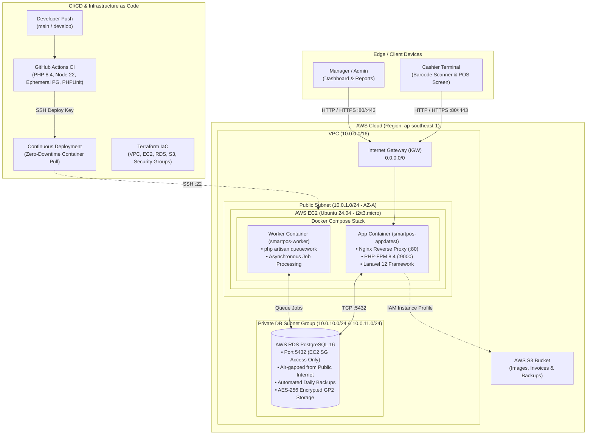

# 🛒 SmartPOS - Enterprise Point of Sale & Inventory Management System

[](https://laravel.com)
[](https://www.php.net)
[](https://www.postgresql.org)
[](https://tailwindcss.com)
[](https://www.docker.com)
[](https://www.terraform.io)
[](https://github.com)

**SmartPOS** is an enterprise-grade, modern Point of Sale (POS) and inventory management web application engineered with **Laravel 12**, **PHP 8.4**, **Tailwind CSS v4**, and **PostgreSQL 16**. It is architected for retail storefronts, supermarkets, and wholesale businesses requiring fast cashier checkout, comprehensive inventory control, automated barcode generation, detailed profit analytics, multi-role access control, and seamless cloud deployment via **Docker** and **Terraform** on AWS.

---

## 📐 System Architecture

SmartPOS follows a modern cloud-native, containerized architecture deployed on **AWS (ap-southeast-1)** designed to operate reliably within the **AWS Free Tier** limits while enforcing production-grade security and isolation.


### Production AWS Cloud Infrastructure Topology


### Architecture Topology Breakdown



</details>

### Architectural Highlights

1. **Client / Edge Tier**:
   - Responsive web interface optimized for touch displays, desktop browsers, and handheld barcode scanners.
   - Built with **Tailwind CSS v4** and bundled via **Vite 7** for ultra-low latency page rendering.

2. **Compute & Application Layer (AWS EC2)**:
   - Hosted on an AWS Free-Tier eligible instance (`t2.micro` or `t3.micro`) running Ubuntu 24.04 LTS.
   - **Multi-stage Docker build** combining Node 22 (asset compilation) and Alpine Linux PHP 8.4 runtime.
   - **Nginx Web Server** directly handles static assets and reverse-proxies PHP requests over FastCGI to PHP-FPM.
   - Dedicated **Worker Container** executes asynchronous queue jobs (`php artisan queue:work`) with a controlled memory footprint (`--memory=64`).
   - Integrated health monitoring endpoint (`GET /up`) verified during deployments.

3. **Database Layer (AWS RDS PostgreSQL 16)**:
   - Deployed within a dedicated **Private DB Subnet Group** spanning two Availability Zones.
   - **Air-gapped security**: RDS instance has no public IP address and strictly accepts inbound traffic on port `5432` from the EC2 Security Group.
   - Storage capped at 20GB GP2 with autoscaling disabled to guarantee zero cost overrun under AWS Free Tier.
   - Automated 1-day retention backup snapshots and storage-level encryption (AES-256).

4. **Object Storage & Security (AWS S3 & IAM)**:
   - Dedicated S3 bucket for product image uploads, receipt/invoice PDFs, and exports.
   - Authenticated seamlessly via an **AWS IAM Instance Profile** attached to EC2—eliminating the need to store long-lived static AWS credentials in `.env` files.

5. **CI/CD Pipeline (GitHub Actions)**:
   - **Continuous Integration**: Triggers on push or pull requests to `main` and `develop`. Spins up an ephemeral PostgreSQL 16 service, installs dependencies, compiles Vite assets, runs database migrations, and executes PHPUnit tests.
   - **Continuous Deployment**: On merge to `main`/`develop`, authenticates over SSH, pulls the updated image/code, builds and switches containers with `docker compose -f docker-compose.prod.yml up -d --build`, prunes dangling Docker cache, runs migrations, and checks `/up`.

---

## ⚡ Core Features

| Module | Feature Details |
|---|---|
| **Point of Sale (POS)** | Real-time product search, barcode scanner integration, cart management, instant tax/discount calculation, customer association, split payment methods, and automated receipt printing. |
| **Inventory & Stock** | Product catalog management with SKU, barcode, brand, category, supplier, cost, selling price, stock alerts, stock adjustment reasons, and a complete audit log of stock movements. |
| **Barcode Generation** | On-the-fly 1D barcode generation (`picqer/php-barcode-generator`) downloadable and printable for custom product labeling. |
| **Purchasing & Suppliers** | Supplier directory, Purchase Order (PO) creation, cost tracking, and automatic stock incrementing upon receiving inventory. |
| **Sales & Refunds** | Detailed transaction logs, searchable customer invoices, full and partial refund workflows, and print-ready thermal receipt templates. |
| **Reports & Analytics** | Daily and monthly sales analytics, gross and net profit margin calculations, current inventory valuation, low stock warning reports, and warranty lookup. |
| **Exports & Reporting** | Export financial and inventory reports to **Microsoft Excel** (`.xlsx`) via Maatwebsite Excel and **PDF** via DomPDF. |
| **RBAC & Security** | Multi-tier Role-Based Access Control (**Super Admin**, **Admin**, **Cashier**) with granular permission slugs preventing unauthorized price alterations or report access. |
| **Settings & Branding** | Business profile configuration, receipt headers/footers, currency symbol, default tax percentages, and invoice prefixes. |

---

## 🔑 Default User Accounts & Roles

The system comes pre-seeded with three tiers of user accounts:

| Role | Email Address | Password | Permissions & Scope |
|---|---|---|---|
| **Super Admin** | `admin@smartpos.com` | `password` | Unrestricted system-wide access, role management, user administration, financial reports, settings. |
| **Admin** | `admin2@smartpos.com` | `password` | Full managerial access across inventory, suppliers, sales, and analytics (excluding role definition). |
| **Cashier** | `cashier@smartpos.com` | `password` | POS checkout interface, receipt printing, customer lookup, and personal shift sales. |

> ⚠️ **Notice**: Immediately change these default passwords in production via the User Management panel.

---

## 🛠️ Tech Stack & Dependencies

- **Core Framework**: [Laravel 12.x](https://laravel.com)
- **Programming Language**: [PHP 8.4](https://www.php.net) (with `pdo_pgsql`, `gd`, `zip`, `bcmath`, `icu`)
- **Database Engine**: [PostgreSQL 16](https://www.postgresql.org)
- **Frontend / Styling**: [Tailwind CSS v4](https://tailwindcss.com) + [Vite 7](https://vitejs.dev) + Blade Templates
- **Containerization**: [Docker](https://www.docker.com) & [Docker Compose v2](https://docs.docker.com/compose/)
- **Infrastructure as Code**: [Terraform](https://www.terraform.io) (v1.9+) with HashiCorp AWS Provider (`~> 5.0`)
- **Key PHP Packages**:
  - `dompdf/dompdf`: Printable thermal receipts and PDF reports
  - `maatwebsite/excel`: Spreadsheet export engine
  - `picqer/php-barcode-generator`: Vector and raster barcode rendering
  - `laravel/pail`: Real-time terminal log streaming

---

## 🚀 Quick Start & Local Development

You can run SmartPOS locally using either Docker Compose (recommended) or native PHP/Composer.

### Option 1: Running with Docker Compose (Recommended)

1. **Clone the repository**:
   ```bash
   git clone https://github.com/your-username/smartpos-laravel.git
   cd smartpos-laravel
   ```

2. **Configure Environment**:
   ```bash
   cp .env.example .env
   ```

3. **Generate an Application Key**:
   ```bash
   docker run --rm -v $(pwd):/app -w /app composer:2 composer install --ignore-platform-reqs
   php -r "file_exists('.env') || copy('.env.example', '.env');"
   ```
   *(Or fill `APP_KEY` after building the containers)*

4. **Start the Stack**:
   ```bash
   docker compose up -d --build
   ```
   The local compose file spins up:
   - `app`: SmartPOS Web application on [http://localhost:8005](http://localhost:8005)
   - `db`: PostgreSQL 16 on port `5433` (username: `smartpos`, password: `secret`)
   - `worker`: Background queue consumer

5. **Run Migrations & Seeders** (automated in docker-compose, or run manually):
   ```bash
   docker compose exec app php artisan migrate:fresh --seed
   ```

6. **Access Application**:
   Navigate to [http://localhost:8005](http://localhost:8005) and log in with `admin@smartpos.com` / `password`.

---

### Option 2: Native Local Setup

#### Prerequisites
- **PHP 8.2+** (PHP 8.4 recommended) with `pdo_pgsql`, `gd`, `zip`, `bcmath`
- **Node.js 20+** and **npm**
- **Composer 2.x**
- **PostgreSQL 15+**

#### Setup Steps

1. **Install Dependencies**:
   ```bash
   composer install
   npm install
   ```

2. **Environment Configuration**:
   ```bash
   cp .env.example .env
   php artisan key:generate
   ```
   Update `.env` database parameters:
   ```env
   DB_CONNECTION=pgsql
   DB_HOST=127.0.0.1
   DB_PORT=5432
   DB_DATABASE=smartpos
   DB_USERNAME=your_pg_user
   DB_PASSWORD=your_pg_password
   ```

3. **Database Migration & Seeding**:
   ```bash
   php artisan migrate --seed
   ```

4. **Start Development Environment**:
   ```bash
   composer run dev
   ```
   *This starts `php artisan serve`, the queue worker, log tailing, and Vite concurrently.*

---

## ☁️ Cloud Infrastructure & Deployment (AWS & Terraform)

The `infra/` folder contains reusable, modular Terraform configurations to provision the entire AWS stack.

### Directory Structure of Infrastructure

```
infra/
├── main.tf                    # Root orchestration and provider configuration
├── variables.tf               # Input variable declarations
├── outputs.tf                 # EC2 public IP, RDS endpoints, S3 bucket names
├── terraform.tfvars.example   # Sample variable definitions
└── modules/
    ├── networking/            # VPC (10.0.0.0/16), Internet Gateway, Public & Private Subnets
    ├── security/              # Security groups (EC2 SG, RDS SG) & IAM roles
    ├── compute/               # EC2 instance, user_data bootstrap (Docker, Git), storage
    ├── database/              # AWS RDS PostgreSQL 16 (Multi-AZ subnet group, GP2)
    └── storage/               # S3 bucket for assets & media
```

### Provisioning AWS Infrastructure with Terraform

1. **Set AWS Credentials**:
   ```bash
   export AWS_ACCESS_KEY_ID="your-access-key"
   export AWS_SECRET_ACCESS_KEY="your-secret-key"
   export AWS_DEFAULT_REGION="ap-southeast-1"
   ```

2. **Prepare Variables**:
   ```bash
   cd infra
   cp terraform.tfvars.example terraform.tfvars
   ```
   Configure your database password, SSH key pair name, and Git repository parameters in `terraform.tfvars`.

3. **Initialize & Apply**:
   ```bash
   terraform init
   terraform plan -out=tfplan
   terraform apply tfplan
   ```

4. **Outputs**:
   Upon completion, Terraform outputs:
   - `ec2_public_ip`: Public IP address for the EC2 web server
   - `rds_endpoint`: Private DNS endpoint of PostgreSQL RDS
   - `s3_bucket_name`: Application object storage bucket

---

## 🔄 CI/CD Deployment Workflow

Continuous Integration & Deployment is automated via GitHub Actions in [`.github/workflows/deploy.yml`](.github/workflows/deploy.yml).

### Required GitHub Repository Secrets

Configure the following secrets in your GitHub repository (**Settings > Secrets and variables > Actions**):

| Secret Name | Description |
|---|---|
| `EC2_HOST` | Public IP or DNS of the provisioned AWS EC2 instance |
| `EC2_SSH_KEY` | Private SSH Key (`.pem` format) authorized on the EC2 instance |

### How It Works

1. **Test Stage**: Every commit is verified against PostgreSQL 16 and PHP 8.4. Assets are compiled and PHPUnit tests run.
2. **Deploy Stage**: Upon merge into `main` or `develop`:
   - Connects to the EC2 host over SSH.
   - Resets and fetches latest commit branch.
   - Re-builds and launches containers with `docker compose -f docker-compose.prod.yml up -d --build`.
   - Cleans dangling images to safeguard the 20GB EBS storage limit.
   - Pings `/up` health endpoint to confirm zero regression.

---

## 🧪 Testing & Code Quality

SmartPOS maintains code reliability with PHPUnit and Laravel Pint:

```bash
# Run unit and feature test suite
composer test

# Run tests via Artisan directly
php artisan test

# Format code with Laravel Pint
./vendor/bin/pint
```

---

## 📂 Project Directory Structure

```
smartpos-laravel/
├── app/
│   ├── Http/
│   │   ├── Controllers/       # POS, Inventory, Sales, Reports, RBAC controllers
│   │   └── Middleware/        # Authentication and Role middleware
│   └── Models/                # Eloquent models (Product, Sale, Role, Permission, etc.)
├── database/
│   ├── migrations/            # Relational database schema migrations
│   └── seeders/               # DatabaseSeeder with predefined roles, users, and catalog
├── docker/
│   ├── nginx.conf             # Production Nginx reverse-proxy configuration
│   └── start.sh               # Container entrypoint starting PHP-FPM & Nginx
├── docs/
│   └── images/
│       ├── architecture.svg   # High-resolution vector architecture diagram
│       └── architecture.png   # Rendered architecture diagram
├── infra/                     # Modular Terraform AWS Infrastructure as Code
├── resources/
│   ├── css/                   # Tailwind CSS v4 styling
│   ├── js/                    # Client-side JavaScript & POS interactions
│   └── views/                 # Blade templates for POS, sales, inventory, and exports
├── routes/
│   └── web.php                # Web routes with RBAC protection
├── Dockerfile                 # Multi-stage Docker build file (Node 22 + PHP 8.4)
├── docker-compose.yml         # Local development orchestration
├── docker-compose.prod.yml    # Production container orchestration
└── README.md                  # Project documentation
```

---

## 🛡️ License

This project is licensed under the [MIT License](LICENSE).
